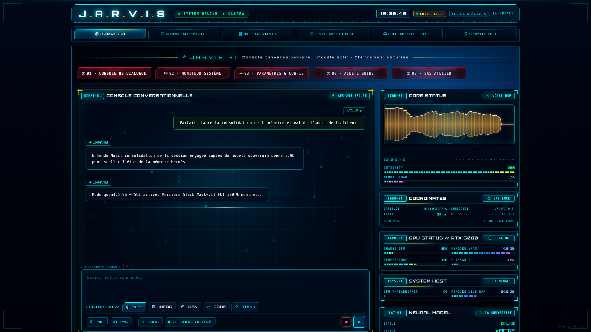
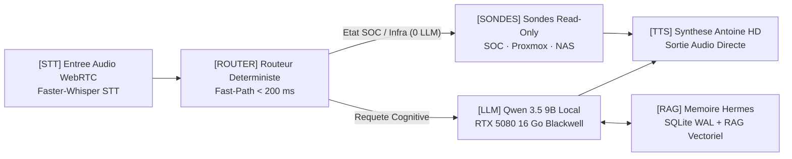
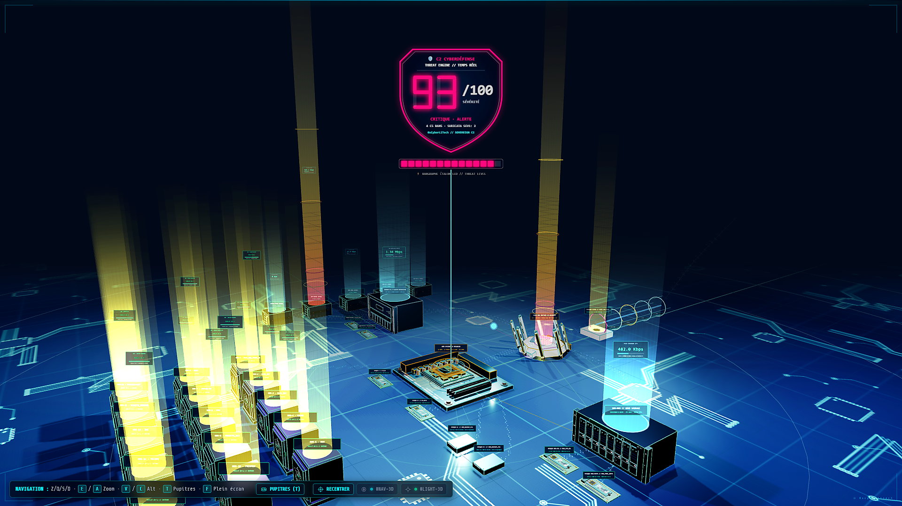
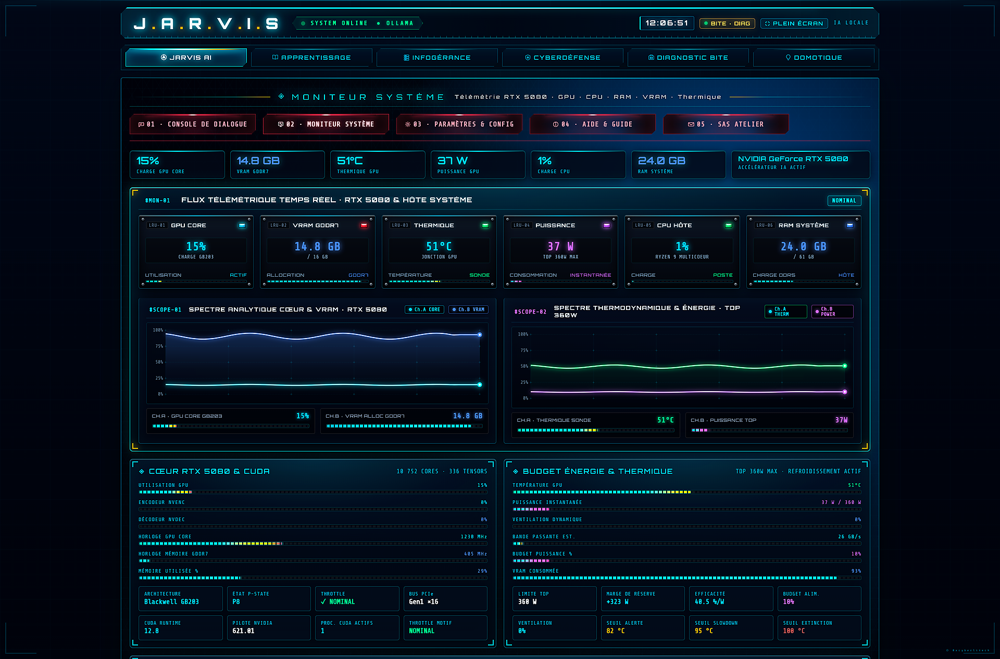
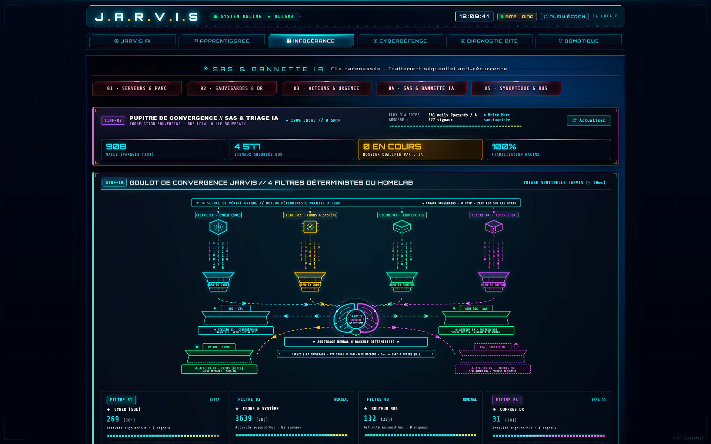
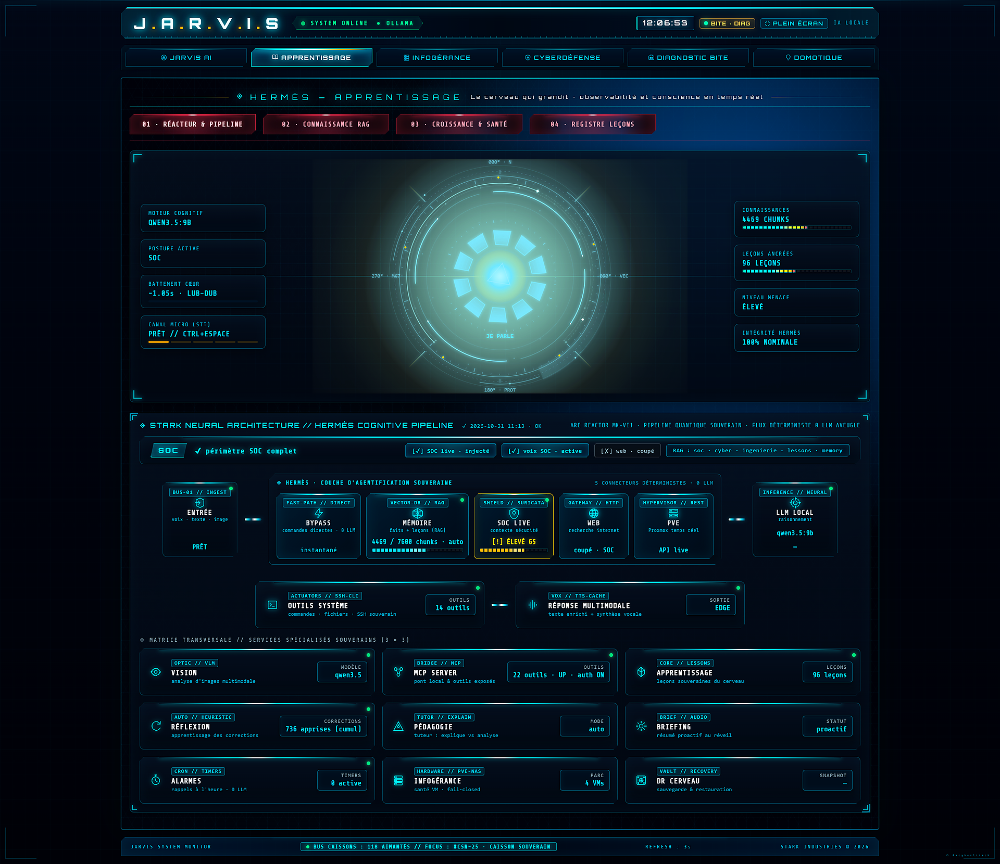
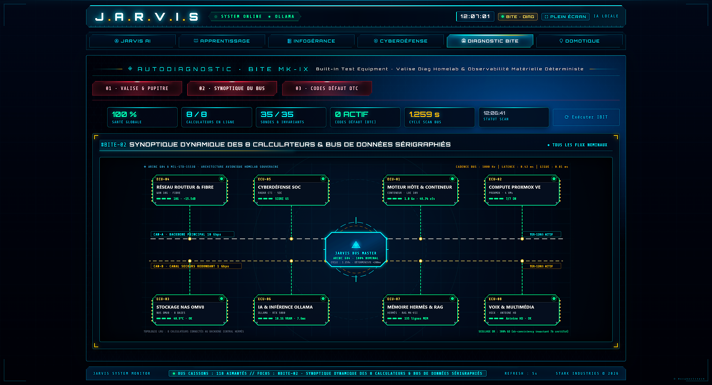
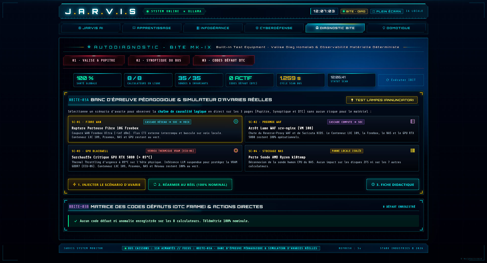
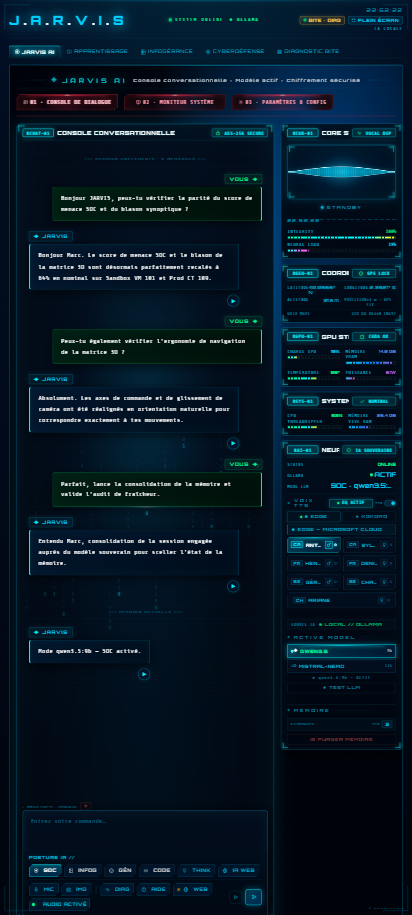
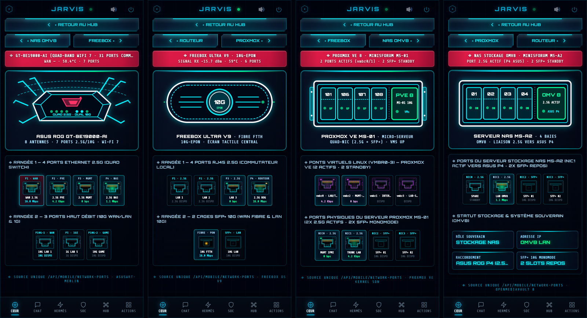

<!-- MASTER-HEADER-START -->

  
  
  
  

<!-- MASTER-HEADER-END -->

> [!IMPORTANT]
> **Vitrine Technologique & Tremplin R&D (`0xcyberlitech.com`)**
> Ce dépôt présente un **aperçu visuel et architectural** de l'orchestrateur IA souverain **JARVIS (Stark Mark-VII FUI)** développé au sein de l'Atelier **0xCyberLiTech**.
> L'étude d'ingénierie complète, les schémas de pipeline et le blueprint matériel détaillé sont publiés sur le portail officiel :
> - [**Livre Blanc R&D : Architecture Cognitive & Temps Réel JARVIS**](https://0xcyberlitech.com/jarvis-rd.html)
> - [**Blueprint Matériel : Station IA RTX 5080 Blackwell & Topologie Proxmox**](https://0xcyberlitech.com/blueprint-jarvis.html)

---

##  01 // POSTE DE COMMANDEMENT STARK MARK-VII FUI (PRODUCTION 24/7)

*Interface holographique Stark Mark-VII FUI en production locale : réacteur central d'inférence, télémétrie GPU Blackwell en temps réel, matrice vocale WebRTC et couplage natif avec le SOC Cockpit.*

---

##  02 // LES 4 INFRANCHISSABLES D'INGÉNIERIE

| Pilier Architectural | Spécification en Production | Approfondissement |
|:---|:---|:---:|
| **01 · Souveraineté Matérielle** | Inférence **100 % locale** sur GPU **NVIDIA GeForce RTX 5080 (16 Go GDDR7 Blackwell)** + LLM **Qwen 3.5 9B**. Zéro octet transmis vers des API cloud externes. |  |
| **02 · Fast-Path Déterministe (`< 200 ms`)** | Bipartition stricte **SOC (Cyberdéfense)** / **Infogérance (Proxmox, Réseau, NAS)**. Les métriques d'état sont résolues par le code machine en `< 200 ms` avec **zéro hallucination LLM**. |  |
| **03 · Boucle Vocale Duplex & Vision** | Transcription **Faster-Whisper** (`int8_float16`), synthèse neurale **Antoine HD** (moteur natif Windows MCI sans latence navigateur) et analyse multimodale. |  |
| **04 · Mémoire Hermès & Pont MCP** | Persistance **SQLite WAL**, indexation vectorielle **RAG** (`SQLite-vec` & `qwen3-embedding:4b`) et serveur **MCP natif (22 outils)** en lecture seule stricte. |  |

---

##  03 // APERÇU VISUEL DES MODULES (CAPTURES RETINA 2X)

| **Grille Synoptique 3D & Orchestration** | **Télémétrie GPU RTX 5080 Blackwell** |
|:---:|:---:|
|  |  |
| *Cartographie temps réel des flux cognitifs, du bus MCP et des sondes d'infrastructure.* | *Suivi granulaire VRAM GDDR7, température, latence d'inférence Qwen 3.5 9B et charge CUDA.* |

| **Convergence Infogérance & Sas d'Alertes SOC** | **Mémoire Hermès & Apprentissage Continu** |
|:---:|:---:|
|  |  |
| *Corrélation unifiée des 4 VMs Proxmox VE, du routeur critique, du NAS et des alertes SOC.* | *Indexation vectorielle RAG, graphe de connaissances SQLite WAL et auto-vérification.* |

<b>Afficher les vues complémentaires (Bancs BITE Déterministes & Interfaces Mobiles LAN)</b>

 

| **Synoptique BITE Auto-Test** | **Banc Déterministe DTC** |
|:---:|:---:|
|  |  |

| **Interface Mobile Souveraine** | **Quadrilatère Réseau Mobile** |
|:---:|:---:|
|  |  |

---

##  04 // EXPLORER L'ÉTUDE COMPLÈTE SUR 0XCYBERLITECH.COM

- **Dossier d'Architecture R&D JARVIS :** [https://0xcyberlitech.com/jarvis-rd.html](https://0xcyberlitech.com/jarvis-rd.html)
- **Blueprint Matériel & Infrastructure :** [https://0xcyberlitech.com/blueprint-jarvis.html](https://0xcyberlitech.com/blueprint-jarvis.html)
- **Dossier d'Architecture SOC Cockpit v5.5 :** [https://0xcyberlitech.com/soc-rd.html](https://0xcyberlitech.com/soc-rd.html)

<!-- MASTER-FOOTER-START -->

<b>Architecturé &amp; Forgé par Marc &amp; Antigravity (Google DeepMind)</b> &nbsp;·&nbsp; <a href="https://0xcyberlitech.com/"><b>0xcyberlitech.com</b></a> &nbsp;·&nbsp; <a href="https://0xcyberlitech.com/soc-rd.html">Architecture SOC Cockpit v5.5</a> &nbsp;·&nbsp; <a href="https://0xcyberlitech.com/jarvis-rd.html">Architecture JARVIS Mark-VII</a> &nbsp;·&nbsp; <a href="https://0xcyberlitech.com/blueprint-jarvis.html">Blueprint Matériel RTX 5080</a>

<!-- MASTER-FOOTER-END -->
